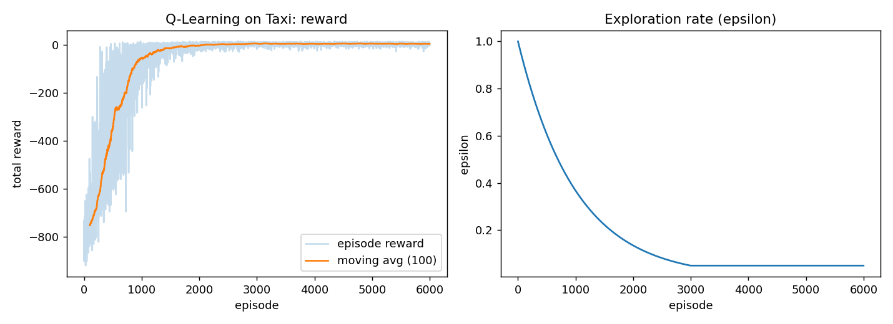
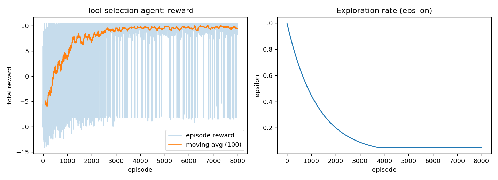

# Reinforcement Learning for AI Agents & Agentic AI

**AI Engineering Internship – Task 5 (A, B, D practical component)**

## 1. Project Overview
This project builds a practical foundation for using **Reinforcement Learning (RL)** in **AI Agents / Agentic AI**.
It has two parts:

| Part | Goal | Environment | Algorithm |
|------|------|-------------|-----------|
| **A. Classic RL** (Task 5A/5B) | Learn the RL loop end-to-end on a standard benchmark | Gymnasium `Taxi` (v3/v4) | Tabular **Q-Learning** |
| **B. Agentic RL** (Task 5D) | Show an AI agent learning *which tool to call* and *when to stop* | Custom `ToolSelectionEnv` (Gymnasium API) | Tabular **Q-Learning** |

Part B is a deliberately small model of the agentic loop:
`Agent -> observes state -> selects action -> uses tool -> receives reward -> updates policy`.

## 2. Why Q-Learning?
- Both environments have **small, discrete** state/action spaces (500x6 and 63x6), so a Q-table is exact and fully inspectable.
- Every number the agent learned can be read from the table, which supports *understanding* the algorithm instead of treating it as a black box.
- It is off-policy, so exploration (epsilon-greedy) and learning target (greedy max) are clearly separated.

Update rule: `Q(s,a) <- Q(s,a) + alpha * [ r + gamma * max_a' Q(s',a') - Q(s,a) ]`

## 3. Part A – Taxi (Gymnasium)
| Item | Definition |
|------|-----------|
| Observation space | `Discrete(500)`: taxi position (25) x passenger location (5) x destination (4) |
| Action space | `Discrete(6)`: south, north, east, west, pickup, dropoff |
| Reward | -1 per step, +20 correct dropoff, -10 illegal pickup/dropoff |
| Termination | Passenger dropped at destination; truncation at 200 steps |
| Why suitable | Discrete, fully observable, dense-enough rewards, fast to train |

Hyperparameters: alpha=0.1, gamma=0.99, epsilon 1.0 -> 0.05 (decay 0.999), 6000 episodes.

**Results (200 test episodes, greedy policy):** 100% success, mean reward **8.2**, mean **12.8 steps**, versus **-766** for a random policy.



## 4. Part B – Tool-Selection Agent (Agentic AI)
Custom environment in `src/tool_env.py`.

| Item | Definition |
|------|-----------|
| State | `(query_type, stage, calls_used)`; query type in {factual, math, data}; stage 0-2 = nothing / info gathered / processed |
| Actions | `web_search, calculator, code_executor, cache_lookup, ask_clarification, final_answer` |
| Transitions | Useful tool advances `stage` (10% random tool failure; cache hits only 30%) |
| Rewards | +10 correct answer, -8 premature answer, +1 progress, -0.2 per step, per-tool cost, -0.5 wrong tool, -3 budget exhausted |
| Budget | Max 6 tool calls per episode |
| Hidden rules | factual -> search; math -> calculator; data -> gather then code_executor |

The agent is never told the rules; it must discover them from rewards.

**Results (500 test episodes):**

| Policy | Success rate | Mean reward | Avg tool calls |
|--------|-------------|-------------|----------------|
| Random | 16.6% | -6.1 | 3.18 |
| Always answer immediately | 0% | -8.2 | 0 |
| **Trained Q-agent** | **99.8%** | **10.06** | **1.67** |

**Learned policy (first step):** factual -> `web_search`, math -> `calculator`, data -> `cache_lookup`
(it learned to try the cheap cache first for data queries, then fall back to the proper tools).



## 5. Actor / State / Action / Reward Table (Part B)
| Actor | Current state | Possible action | Tool/Resource | Reward/Payoff | Next state |
|-------|---------------|-----------------|---------------|---------------|-----------|
| LLM Agent | math, stage 0 | call calculator | Calculator | +1 -0.2 -0.2 | math, stage 1 |
| LLM Agent | math, stage 1 | final_answer | - | +10 -0.2 | terminal (success) |
| LLM Agent | factual, stage 0 | web_search | Search API | +1 -0.2 -0.5 | factual, stage 1 |
| LLM Agent | data, stage 0 | cache_lookup | Cache | +1 -0.3 (30% hit) | data, stage 1 or stay |
| LLM Agent | data, stage 1 | code_executor | Python sandbox | +1 -1.0 | data, stage 2 |
| LLM Agent | any, stage 0 | final_answer | - | -8.2 | terminal (failure) |
| LLM Agent | any, calls = 6 | (budget out) | - | -3 | truncated |

## 6. Limitations (and link to Task 5D)
This toy setup is **not** a replacement for training LLM agents. Real LLM agents face: expensive rollouts, sparse/delayed rewards,
huge (text) action spaces, credit assignment over long workflows, non-deterministic outputs and safety risks. Here the state is hand-engineered
and the action set tiny. Realistic next steps: bandit-style tool routing on top of an LLM, DQN with learned state embeddings, PPO/RLHF-style fine-tuning, and
multi-agent extensions with Game Theory (Task 5E).

## 7. Project Structure
```
src/q_learning.py        Q-Learning agent (epsilon-greedy, TD update)
src/train_taxi.py        Part A: train/evaluate on Gymnasium Taxi
src/tool_env.py          Part B: custom Gymnasium environment
src/train_tool_agent.py  Part B: train/evaluate tool-selection agent
src/utils.py             Plot helpers
results/                 Plots, JSON metrics, saved Q-tables
```

## 8. How to Run
```bash
pip install -r requirements.txt
cd src
python train_taxi.py
python train_tool_agent.py
```
Outputs are written to `results/`.

## 9. Next Steps (planned)
- Add SARSA and DQN for comparison (Task 5A table).
- Plug in your **own case study** actors/tools into `tool_env.py` (replace tools, states, rewards).
- Add a Game Theory module (payoff matrices, Nash equilibrium) for multi-agent scenarios (Task 5C/5E).
- Draw architecture, workflow, flow and state diagrams for the report.

## 10. References
- Sutton & Barto, *Reinforcement Learning: An Introduction* (2nd ed.)
- Gymnasium documentation: https://gymnasium.farama.org
- Watkins & Dayan (1992), *Q-learning*
